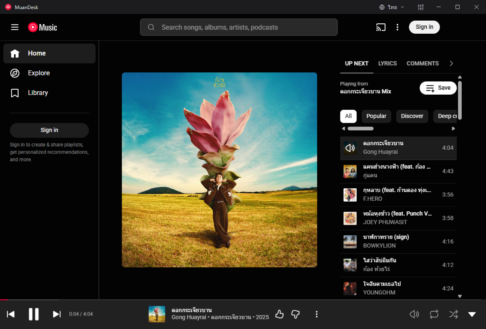
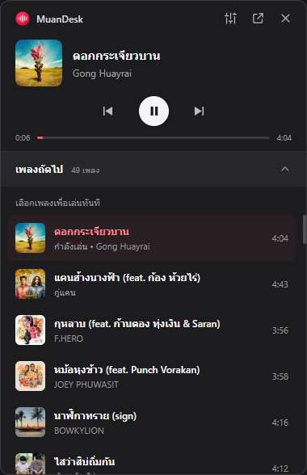
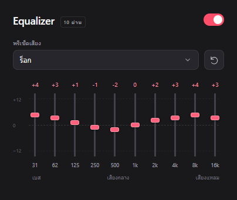

# MuanDesk


An independent, open-source Windows desktop companion for YouTube Music, with tray playback
controls, a selectable queue, and a 10-band equalizer.

MuanDesk is not affiliated with, endorsed by, or sponsored by Google or YouTube.
YouTube and YouTube Music are trademarks of their respective owners. MuanDesk's GPL-3.0-only license
covers this project's original code and icon, not the website, music, artwork or trademarks.

## Features

- Hide the main window while music continues playing.
- Control playback using Windows media controls or the tray mini player.
- Expand the current queue and click a song to play it.
- Adjust ten frequency bands from 31 Hz to 16 kHz, with presets and a remembered custom setting.
- Open a separate EQ window from the sliders button beside the main window's minimize button.
- Switch the app interface between Thai and English using the language dropdown to the left of EQ.
- Reduce strong audio peaks dynamically, instead of turning down the whole song based on EQ boost.

MuanDesk loads the real website and keeps its advertisements, account requirements and service
restrictions. It does not provide music downloads, ad blocking, or subscription bypasses.

## Download and run

Download `MuanDesk-Setup-VERSION-x64.exe` from this repository's Releases page. Run the setup,
choose Thai or English for the installer, review the license, and choose an installation folder.
Setup installs for the current Windows user and creates Desktop and Start Menu shortcuts.
Open MuanDesk from either shortcut. Uninstall through Windows Settings > Apps > Installed apps.
No ZIP extraction or Node.js installation is needed. Windows x64 is the supported target.
Releases are currently unsigned and have no automatic updater.

ดาวน์โหลด `MuanDesk-Setup-VERSION-x64.exe` แล้วเปิดเพื่อติดตั้ง เลือกภาษาและโฟลเดอร์ได้
เมื่อติดตั้งเสร็จให้เปิดจากไอคอนบน Desktop หรือ Start Menu ถอนการติดตั้งผ่าน Settings ของ Windows
ได้ตามปกติ โดยข้อมูลเข้าสู่ระบบและการตั้งค่าในเครื่องจะยังเก็บไว้หลังถอนการติดตั้ง

## Screenshots

### Main window



### Mini player and equalizer

| Mini player and queue | Equalizer |
| --- | --- |
|  |  |

These are actual screenshots of MuanDesk running the live YouTube Music website, its current
song queue, and the equalizer. They were captured from a fresh, signed-out profile, without
mock track data or generated artwork. Music titles and cover artwork belong to their respective
rights holders and are shown here to illustrate the app. Regenerate with `npm run screenshots`
and review all three images for personal information before publishing.

The application requires internet access. Sign-in takes place on Google's website in a separate
local browser profile. Google may reject embedded-browser sign-ins. Website changes can also
affect playback controls or queue extraction. Background playback does not keep a sleeping
computer playing audio, and Windows decides when its media card appears.

## วิธีใช้งาน

1. เปิด `MuanDesk.exe` แล้วเลือกเพลงบน YouTube Music
2. กด X หรือ `Ctrl+Shift+H` เพื่อซ่อนหน้าต่าง เพลงยังเล่นต่อ
3. คลิกไอคอนคลื่นเสียงข้างนาฬิกาเพื่อเปิดการ์ดเล็ก หรือกด `Win+A` เพื่อเปิดส่วนควบคุมสื่อของ Windows
4. กดเพลงถัดไปเพื่อขยายคิว แล้วคลิกเลือกเพลงได้โดยตรง
5. กดไอคอน EQ บนการ์ดเล็ก หรือข้างปุ่มย่อหน้าต่างหลัก เพื่อปรับเสียง
6. เลือกพรีเซ็ตหรือปรับสไลเดอร์ ค่า “ปรับเอง” จะจำแยกจากพรีเซ็ตอื่น ดับเบิลคลิกสไลเดอร์เพื่อคืนย่านนั้นเป็นศูนย์
7. กด `Ctrl+Q` หรือเมนูออกจากแอปบนไอคอนถาดระบบเพื่อปิดจริง

EQ มีผลเฉพาะเสียงในแอปนี้ ค่าจากหน้าต่าง EQ และการ์ดเล็กจะอัปเดตถึงกัน แหล่งเสียงที่ติดข้อจำกัด
CORS หรือ DRM อาจใช้ EQ ไม่ได้ ชื่อและไอคอน MuanDesk เป็นของโครงการนี้ ส่วน YouTube Music
เป็นบริการภายนอก การเปิดซอร์สไม่ได้ทำให้โครงการได้รับอนุญาตจาก Google โดยอัตโนมัติ

เลือกภาษาไทยหรือ English จาก dropdown รูปลูกโลกทางซ้ายของปุ่ม EQ บนหน้าต่างหลัก ภาษาของ
เมนูถาดระบบ การ์ดเพลง และหน้าต่าง EQ จะเปลี่ยนทันทีและจำไว้หลังปิดเปิดแอป ภาษาในเว็บไซต์
YouTube Music และปุ่มมาตรฐานของ Windows ใช้การตั้งค่าของบริการและระบบนั้น ๆ

## Privacy

MuanDesk has no developer-operated analytics or account server. The embedded website still
communicates with Google/YouTube under their own policies. Cookies, cache, sign-in state and
EQ preferences remain in the local AppData profile. They are not included in release archives.
See [PRIVACY.md](PRIVACY.md) for storage locations, upgrade behavior and diagnostics.

Never upload your profile or the development `artifacts/` folder. It may contain private
screenshots and diagnostic data. Use the allowlisted source ZIP when creating a public repository.

## Development

Use Windows x64 and Node.js 22.12 or newer.

```powershell
npm ci
npm start
```

The local UI uses React and esbuild. The remote website runs in a sandboxed WebContentsView
without Node.js or a preload bridge. Local controls have separate, restricted IPC interfaces.
Chromium connects the website's Media Session metadata to Windows media controls. Queue
controls depend on the website's DOM and may need maintenance when the site changes.

```powershell
npm run test:navigation
npm run test:queue
npm run test:release
npm run test:equalizer
npm run test:main-equalizer
npm run test:language
npm test
npm run test:mini
npm run test:live
```

Audio tests produce sound. Live tests require a working network and available YouTube content.
Tests use temporary profiles and put generated screenshots in ignored `artifacts/` files.
`npm run test:login` checks the Google sign-in entry route without submitting credentials.

## Build and release

```powershell
npm audit
npm run release:check
npm run installer
npm run release
```

The release command builds the application from an explicit runtime allowlist and produces:

- `dist/releases/MuanDesk-VERSION-source.zip` for the public source repository.
- `dist/releases/MuanDesk-Setup-VERSION-x64.exe` for Windows users.
- `dist/releases/SHA256SUMS.txt` and `RELEASE-AUDIT.json` for verification.

The privacy checks reject prohibited profile filenames and known secret/personal-data patterns.
They reduce accidental disclosure but cannot detect every possible secret. Review the exported
files before publishing. Nothing is uploaded automatically. See [docs/RELEASING.md](docs/RELEASING.md).

## Contributing and license

See [CONTRIBUTING.md](CONTRIBUTING.md) and [SECURITY.md](SECURITY.md).
Original project code and the wave icon use the [GNU GPL version 3 only](LICENSE).
See [NOTICE](NOTICE) for the copyright and warranty notice and [SOURCE.md](SOURCE.md) for
matching-source availability and redistribution/build instructions. Publish the Setup EXE
and its matching source ZIP together on the same release page. The source ZIP includes
the pinned React/React DOM and Scheduler source archives described in [third_party/README.md](third_party/README.md).
Versions previously distributed under MIT retain the permissions granted for those versions.
Redistributions must retain [third-party notices](THIRD_PARTY_NOTICES.md) and the Electron/Chromium
license files supplied with the binary.

